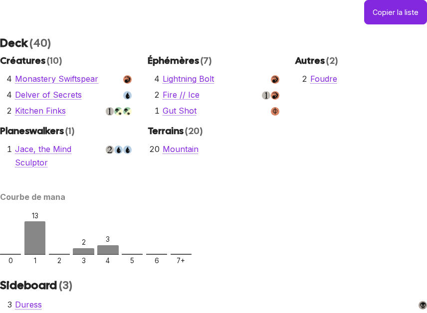

# MTG Decklist

[](https://github.com/Exe64/grav-plugin-mtg-decklist/actions/workflows/ci.yml)

Grav plugin: paste a Magic: The Gathering deck exported from Arena or MTGO into a page, and it becomes a deck list
grouped by card type, with mana costs, the mana curve and a "Copy the list" button. Each card shows its image on
hover through [Scryfall Tooltip](https://github.com/Exe64/grav-plugin-scryfall-tooltip). Made for
[magicthegathering.fr](https://magicthegathering.fr).



## Installation

Requires Grav 2.2+, [shortcode-core](https://github.com/getgrav/grav-plugin-shortcode-core) and
[scryfall-tooltip](https://github.com/Exe64/grav-plugin-scryfall-tooltip) 2.0+ (both installed with it by gpm).

```
bin/gpm install mtg-decklist
```

Manual install: copy this repository to `user/plugins/mtg-decklist`, and install the two plugins above.

## Settings

`user/config/plugins/mtg-decklist.yaml`, or the plugin page in the admin:

```yaml
enabled: true
scryfall_lookup: true   # false: no request to Scryfall on page load, see Network behaviour
```

## Usage

Paste the export between `[mtgdeck]` and `[/mtgdeck]`:

```
[mtgdeck]
Deck
4 Lightning Bolt (M10) 146
4 Monastery Swiftspear
20 Mountain

Sideboard
3 Duress
[/mtgdeck]
```

- Arena: `Deck`, `Sideboard`, `Commander` and `Companion` headers; the `About` block is left out.
  MTGO: the sideboard follows the first blank line, or lines starting with `SB:`. `4x` is accepted, and so are
  Moxfield's `*F*` and `*E*` markers (removed).
- An export without headers (Moxfield's, for instance) names its commander as a parameter:
  `[mtgdeck commander="Animar, Soul of Elements"]` moves that card from the main deck to the Commander section.
- A double-faced card written `Front / Back` is read as `Front // Back`.
- A line that is neither a card nor a header is left out. A `[mtgdeck]` block without any card line is left as is.
- `(M10) 146` after a name points the tooltip to that printing, and the grouping asks Scryfall for that printing:
  flavor names (`Mechagodzilla, Battle Fortress`) are found that way. Arena's set code is passed as is: where it
  differs from Scryfall's (`DAR` for Dominaria, for instance), the grouping asks again by name, but the tooltip says
  the card is not found. Remove the set to fall back to the card name.
- Without JavaScript the list is still there, as sections with their totals, each card a link to Scryfall.
  The same list ends up in blog summaries and in feeds.

## Network behaviour

When a page with a deck opens, the reader's browser sends the cards of the page to Scryfall
(`api.scryfall.com/cards/collection`, by printing when the export gives it, by name otherwise, up to 75 per request) to get their types and mana costs. Scryfall
therefore sees the reader's IP address as soon as the page loads, not only on hover as with Scryfall Tooltip alone.
Nothing is stored on the server, no cookie is set.

With `scryfall_lookup: false`, the script sends nothing: the list stays as the server rendered it (sections with
their totals, no grouping by type, no mana costs, no curve), with the "Copy the list" button. Scryfall Tooltip still
asks for the card image on hover.

If Scryfall does not answer, the list stays as the server rendered it. Names must be in English for the grouping:
a card Scryfall does not recognise (a French name, for instance) goes to "Other". Mana symbols come with the
plugin: no request goes to Scryfall's symbol images.

## Details

- Main deck grouped by the type of the front face: creatures, planeswalkers, battles, instants, sorceries,
  artifacts, enchantments, lands, other. Commander and sideboard keep their order.
- Mana curve of the main deck, lands left out, 0 to 7+.
- "Copy the list" copies the deck in Arena format (needs HTTPS, as the clipboard does).
- Interface text in French when the page is `lang="fr"`, English otherwise: the section headings from
  `languages.yaml` (the page language, else `site.default_lang`), the rest from the script. The copied list keeps
  Arena's English headers. Colours and fonts come from the theme.

## Licences

Code under the MIT licence. Mana symbols from [Mana](https://mana.andrewgioia.com) by Andrew Gioia: the font
(`assets/fonts/mana.woff2`) under the SIL Open Font License 1.1 (`assets/fonts/OFL.txt`), its CSS under the MIT
licence (`assets/mana.css`, reduced to the mana cost symbols). Mana symbols, card names and card images are
© Wizards of the Coast; card images are served by Scryfall.
